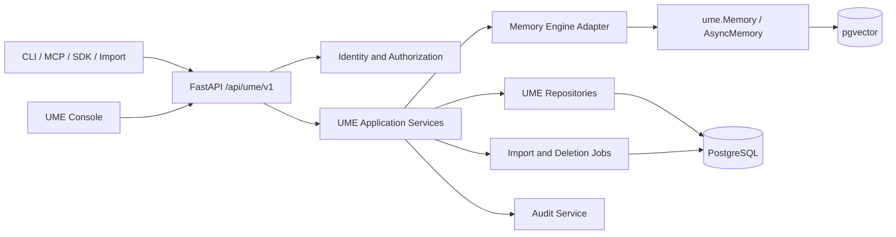

# UME V1.0 技术实现文档

**文档版本：** V1.1  
**文档日期：** 2026-10-10  
**目标执行者：** MiniMax 开发代理及人工研发  
**代码基线：** `fc9688e7232d7a16d724d2d147bdf9fd587bf9c2`  
**配套文档：** `docs/specs/UME-V1-PRD.md`

## 1. 实施目标

在不重写现有记忆引擎的前提下，将当前仓库扩展为可本地部署的统一 AI 记忆平台。实施重点是新增 UME 业务层，而不是继续把所有逻辑堆入 `server/main.py`。

本文件是 MiniMax 的开发执行依据。MiniMax 必须按阶段提交小型、可测试的变更，不得一次性生成全部模块。

## 2. 代码审查结论

### 2.1 Python SDK

- 目录：`ume/`
- 公共入口：`ume/__init__.py`
- 核心实现：`ume/memory/main.py`
- 当前能力：同步/异步记忆 CRUD、搜索、历史、模型和向量存储适配。
- 默认业务历史仍使用 `history_db_path` 指向的 SQLite。
- 当前顶层包未发现独立的 UME 关系图谱业务模块。

实施约束：

- 不在 V1.0 重写 `Memory` 和 `AsyncMemory`。
- 通过适配器封装核心记忆调用，业务表只保存引擎记忆 ID 和 UME 元数据。
- 引擎写入与业务来源写入无法使用同一个数据库事务时，必须采用可恢复状态或 outbox，不得假装具备原子性。

### 2.2 自托管 Server

- 入口：`server/main.py`
- 当前路由：记忆 CRUD/搜索、配置、认证、API Key、实体、请求日志。
- 当前模型：`User`、`APIKey`、`RequestLog`、`RefreshTokenJti`、`Settings`。
- 当前迁移：`001` 至 `006`，尚无 UME 业务表。
- 当前数据库：应用表使用 `APP_DB_NAME=ume_app`；向量数据使用同一 PostgreSQL 实例中的引擎配置数据库。
- 当前认证：首次注册单管理员；JWT 和用户 API Key；没有工作区或项目授权。

主要问题：

- `server/main.py` 已承担过多职责。
- 记忆接口没有工作区边界。
- 现有 API 响应不符合 PRD 中统一 `data/error/request_id` 结构。
- 配置接口应限制管理员访问并明确热更新边界。

### 2.3 Dashboard

- 目录：`server/dashboard/`
- 技术栈：Next.js 15、React 19、TypeScript、Redux、Tailwind、Radix UI。
- 现有页面：Memories、Entities、Requests、API Keys、Configuration、Settings。
- 暂无前端测试文件。
- Categories、Webhooks、Analytics、Export 仍被标记为云端或受限能力。

实施约束：

- 复用现有设计系统和认证流程。
- 新业务页面放在现有 App Router 结构内。
- 引入 React Flow 前先确认依赖；若引入，必须记录原因并限制只用于图谱页面。

### 2.4 CLI

- Python CLI：`cli/python/src/ume_cli/`
- Node CLI：`cli/node/src/`
- 共享规范：`cli/cli-spec.json`
- 当前 CLI 默认指向 `https://api.ume.ai`，接口路径为托管平台风格的 `/v1`、`/v2`。

主要问题：

- 与本地 Server 路由不一致。
- 两套 CLI 同时维护，容易发生行为漂移。

实施决策：

- `cli/cli-spec.json` 继续作为行为契约。
- V1.0 优先让 Node/Python CLI 共享同一组 UME 业务 API 定义和契约测试。
- 增加 `profile` 概念：默认 `local` 指向 `http://localhost:8888`，用户可配置远程实例。

### 2.5 MCP 与集成

- `integrations/agent-plugin-core/python/mcp_server.py` 当前只暴露 `search_memories`。
- OpenClaw 等集成拥有独立工具集，但不是统一的 UME MCP Server。
- 现有插件生成流程以 `integrations/agent-plugin-core/` 为源，生成目录不得手工修改。

实施决策：

- 新建独立的 UME MCP Server 包，调用 UME REST API。
- 现有编辑器插件保留；后续按需切换到新 MCP Server。
- 不直接在每个生成插件内重复实现工具。

### 2.6 测试与 CI

- 仓库已有大量 Python/TypeScript 测试，但主要覆盖引擎、CLI 和集成。
- Dashboard 当前没有自动化测试。
- 当前仓库没有 `.github/workflows/`。

实施决策：

- 新业务测试放在 `server/tests/ume/` 或经团队确认的独立 `tests/ume/`，不能污染引擎测试语义。
- 未获得维护者明确批准前，不创建或修改 `.github/workflows/`。

## 3. 目标架构



V1.0 采用模块化单体：一个 FastAPI 应用、一个 PostgreSQL 实例、一个 Dashboard、一个可独立启动的 MCP 进程。不要拆成微服务。

## 4. 建议目录结构

在 `server/` 内增加独立业务包，避免与顶层 `ume/` SDK 同名冲突：

```text
server/
├── main.py
├── ume_app/
│   ├── api/
│   │   ├── router.py
│   │   └── routes/
│   │       ├── workspaces.py
│   │       ├── projects.py
│   │       ├── conversations.py
│   │       ├── memories.py
│   │       ├── graph.py
│   │       ├── timeline.py
│   │       ├── context.py
│   │       └── connectors.py
│   ├── auth/
│   │   ├── permissions.py
│   │   └── dependencies.py
│   ├── domain/
│   │   ├── enums.py
│   │   └── errors.py
│   ├── models/
│   ├── schemas/
│   ├── repositories/
│   ├── services/
│   ├── engine/
│   │   └── memory_adapter.py
│   ├── jobs/
│   └── settings.py
└── tests/ume/
```

规则：

- 路由只做 HTTP 解析、依赖注入和响应转换。
- 服务层负责用例和事务边界。
- Repository 负责数据库查询，并在查询层强制工作区范围。
- Pydantic schema 与 SQLAlchemy model 分离。
- 禁止从路由直接调用全局 `get_memory_instance()` 完成复杂业务流程。

## 5. 数据模型

所有 UUID 使用 PostgreSQL UUID 类型。所有时间使用带时区 UTC。业务表统一包含 `created_at`，可变对象包含 `updated_at`。

### 5.1 工作区与授权

#### `ume_workspaces`

| 字段 | 类型 | 约束 |
| --- | --- | --- |
| id | UUID | PK |
| name | VARCHAR(255) | NOT NULL |
| description | TEXT | NULL |
| owner_user_id | UUID | FK users.id |
| status | VARCHAR(32) | active/archived/deleting |
| default_memory_policy | JSONB | NOT NULL DEFAULT '{}' |
| created_at | TIMESTAMPTZ | NOT NULL |
| updated_at | TIMESTAMPTZ | NOT NULL |

#### `ume_workspace_members`

唯一约束：`(workspace_id, user_id)`。

字段：`workspace_id`、`user_id`、`role`、`created_at`、`updated_at`。

#### `ume_projects`

字段：`id`、`workspace_id`、`name`、`description`、`tags JSONB`、`status`、`created_at`、`updated_at`、`last_activity_at`。

索引：`workspace_id`、`(workspace_id, status)`、`last_activity_at`。

### 5.2 连接器

#### `ume_connectors`

字段：

- `id UUID PK`
- `workspace_id UUID FK`
- `project_id UUID NULL FK`
- `name VARCHAR(255)`
- `connector_type VARCHAR(64)`
- `client_instance_id VARCHAR(255) NULL`
- `credential_prefix VARCHAR(16)`
- `credential_hash TEXT`
- `scopes JSONB`
- `capabilities JSONB`
- `status VARCHAR(32)`
- `created_by UUID FK users.id`
- `last_active_at TIMESTAMPTZ NULL`
- `revoked_at TIMESTAMPTZ NULL`
- `created_at/updated_at`

不保存明文凭证。连接器认证解析后生成 `Principal`：

```python
Principal(
    actor_type="connector",
    actor_id=connector.id,
    workspace_id=connector.workspace_id,
    project_id=connector.project_id,
    scopes=set(connector.scopes),
)
```

### 5.3 对话与消息

#### `ume_conversations`

字段：`id`、`workspace_id`、`project_id NULL`、`connector_id NULL`、`external_conversation_id NULL`、`title`、`source_type`、`retention_policy`、`status`、`started_at NULL`、`last_message_at NULL`、`created_at/updated_at`。

唯一约束：当外部 ID 存在时，`(workspace_id, connector_id, external_conversation_id)`。

#### `ume_messages`

字段：`id`、`workspace_id`、`conversation_id`、`external_message_id NULL`、`role`、`content_text NULL`、`content_ref JSONB NULL`、`content_hash CHAR(64)`、`metadata JSONB`、`sensitivity`、`message_at`、`import_job_id NULL`、`deleted_at NULL`、`created_at`。

约束与索引：

- 唯一候选：`(conversation_id, external_message_id)`，仅外部 ID 非空时生效。
- 去重索引：`(conversation_id, content_hash, message_at)`。
- 浏览索引：`(conversation_id, message_at, id)`。
- `content_text` 与 `content_ref` 至少一个非空。

### 5.4 记忆业务元数据

#### `ume_memory_records`

不复制向量或引擎正文的全部历史，只维护业务投影：

- `id UUID PK`
- `workspace_id UUID FK`
- `engine_memory_id VARCHAR(255)`
- `memory_type VARCHAR(64)`
- `status VARCHAR(32)`
- `current_text TEXT`
- `tags JSONB`
- `access_scope JSONB`
- `engine_state VARCHAR(32)`：pending/ready/failed/deleting/deleted
- `engine_error TEXT NULL`
- `created_by_type/created_by_id`
- `created_at/updated_at/deleted_at`

唯一约束：`(workspace_id, engine_memory_id)`。

`current_text` 是用于页面和版本管理的业务投影；引擎仍是语义检索的来源。服务必须检测两者不一致并提供修复任务。

#### `ume_memory_projects`

多对多关系：`memory_record_id`、`project_id`、`created_at`。唯一约束 `(memory_record_id, project_id)`。

#### `ume_memory_sources`

字段：`id`、`workspace_id`、`memory_record_id`、`conversation_id NULL`、`message_id NULL`、`source_type`、`extraction_method`、`evidence_excerpt NULL`、`confidence NULL`、`created_at`。

删除来源正文时：将 `message_id` 置空或保留受约束的墓碑引用，必须确保无法通过接口返回已删除正文。

#### `ume_memory_versions`

字段：`id`、`memory_record_id`、`version_no`、`text`、`metadata JSONB`、`change_type`、`change_reason NULL`、`actor_type`、`actor_id`、`created_at`。

唯一约束：`(memory_record_id, version_no)`。

### 5.5 关系与事件

#### `ume_memory_edges`

字段：`id`、`workspace_id`、`source_memory_id`、`target_memory_id`、`relation_type`、`status`、`evidence_ref JSONB`、`created_by_type/created_by_id`、`created_at/updated_at`。

约束：起点不能等于终点；同一有效边建立组合唯一索引。

#### `ume_audit_events`

字段：`id`、`workspace_id NULL`、`actor_type`、`actor_id`、`action`、`resource_type`、`resource_id NULL`、`result`、`request_id`、`details JSONB`、`created_at`。

`details` 只能包含非敏感摘要和资源 ID。

#### `ume_import_jobs`

字段：`id`、`workspace_id`、`project_id NULL`、`connector_id NULL`、`idempotency_key`、`status`、`input_summary JSONB`、`result_summary JSONB`、`error_summary JSONB`、`created_by`、`created_at/started_at/completed_at`。

唯一约束：`(workspace_id, idempotency_key)`。

## 6. 数据库迁移计划

不要把全部表放在单个迁移中。

建议序列：

1. `007_create_workspaces_projects.py`
2. `008_create_connectors.py`
3. `009_create_conversations_messages.py`
4. `010_create_memory_metadata_sources_versions.py`
5. `011_create_memory_edges_audit.py`
6. `012_create_import_jobs.py`
7. 后续迁移只做索引优化或约束修正。

每个迁移必须：

- 提供明确 downgrade，无法安全 downgrade 时写明原因并阻止执行。
- 在空数据库执行 upgrade/downgrade/upgrade 测试。
- 在已有 `001` 至 `006` 数据库上执行升级测试。
- 不删除现有用户、API Key、请求日志或设置。

## 7. 认证与授权设计

### 7.1 主体类型

- `user`：JWT 或现有用户 API Key。
- `connector`：新连接器凭证。
- `system`：后台任务，必须携带明确系统动作名。

### 7.2 权限检查顺序

1. 认证凭证并生成 `Principal`。
2. 从路径资源解析真实工作区，不信任请求体中的工作区声明。
3. 验证工作区成员身份或连接器工作区。
4. 验证项目边界。
5. 验证操作 scope。
6. 在 Repository 查询中加入工作区/项目条件。
7. 记录成功或失败审计事件。

### 7.3 Scope 建议

- `workspace:read`
- `project:read`
- `conversation:read`
- `conversation:write`
- `memory:read`
- `memory:write`
- `context:read`
- `graph:read`
- `graph:write`
- `export:read`

用户角色映射到 scope；连接器直接保存最小 scope 集合。

## 8. Memory Engine Adapter

新增 `server/ume_app/engine/memory_adapter.py`，屏蔽核心 SDK 的具体调用。

接口建议：

```python
class MemoryEngineAdapter(Protocol):
    def add(self, messages, *, scope, metadata, infer=True) -> list[EngineMemory]: ...
    def search(self, query, *, scope, filters, limit) -> list[EngineMemory]: ...
    def get(self, memory_id: str) -> EngineMemory: ...
    def update(self, memory_id: str, text: str, metadata=None) -> EngineMemory: ...
    def delete(self, memory_id: str) -> None: ...
    def history(self, memory_id: str) -> list[EngineHistoryItem]: ...
```

业务 scope 必须映射到引擎 metadata 和过滤器：

```json
{
  "ume_workspace_id": "...",
  "ume_project_ids": ["..."],
  "ume_memory_record_id": "..."
}
```

安全要求：搜索前提供工作区过滤，搜索后再次验证业务记录归属。仅做结果后过滤不够安全，也会导致跨租户候选数据进入排序过程。

## 9. API 设计

### 9.1 路由前缀

UME 新业务统一使用 `/api/ume/v1`。现有 `/memories`、`/search` 暂时保留为引擎兼容路由，标记为 legacy，不在新 Console、CLI 或 MCP 中使用。

### 9.2 响应格式

成功：

```json
{
  "data": {},
  "request_id": "req_..."
}
```

分页：

```json
{
  "data": {
    "items": [],
    "next_cursor": null,
    "has_more": false
  },
  "request_id": "req_..."
}
```

失败：

```json
{
  "error": {
    "code": "PERMISSION_DENIED",
    "message": "当前主体无权访问该资源",
    "details": null
  },
  "request_id": "req_..."
}
```

### 9.3 必须实现的接口

#### 工作区与项目

- `GET/POST /api/ume/v1/workspaces`
- `GET/PATCH/DELETE /api/ume/v1/workspaces/{workspace_id}`
- `GET/POST /api/ume/v1/workspaces/{workspace_id}/members`
- `PATCH/DELETE /api/ume/v1/workspaces/{workspace_id}/members/{user_id}`
- `GET/POST /api/ume/v1/workspaces/{workspace_id}/projects`
- `GET/PATCH/DELETE /api/ume/v1/projects/{project_id}`

#### 对话

- `GET/POST /api/ume/v1/conversations`
- `GET/PATCH/DELETE /api/ume/v1/conversations/{conversation_id}`
- `GET/POST /api/ume/v1/conversations/{conversation_id}/messages`
- `POST /api/ume/v1/conversations/imports/preview`
- `POST /api/ume/v1/conversations/imports`
- `GET /api/ume/v1/import-jobs/{job_id}`
- `POST /api/ume/v1/import-jobs/{job_id}/retry`

#### 记忆

- `GET/POST /api/ume/v1/memories`
- `GET/PATCH/DELETE /api/ume/v1/memories/{memory_id}`
- `GET /api/ume/v1/memories/{memory_id}/sources`
- `GET /api/ume/v1/memories/{memory_id}/versions`
- `POST /api/ume/v1/memories/{memory_id}/restore`
- `POST /api/ume/v1/memories/{memory_id}/archive`
- `POST /api/ume/v1/memories/{memory_id}/forget`
- `POST /api/ume/v1/memory-search`

#### 图谱、时间线和上下文

- `GET /api/ume/v1/graph`
- `GET /api/ume/v1/graph/nodes/{node_id}/neighbors`
- `POST/PATCH/DELETE /api/ume/v1/graph/edges...`
- `GET /api/ume/v1/timeline`
- `POST /api/ume/v1/context`

#### 连接器与导出

- `GET/POST /api/ume/v1/connectors`
- `GET/PATCH /api/ume/v1/connectors/{connector_id}`
- `POST /api/ume/v1/connectors/{connector_id}/revoke`
- `POST /api/ume/v1/exports`
- `GET /api/ume/v1/exports/{export_id}`

### 9.4 幂等性

以下接口支持 `Idempotency-Key`：

- 对话导入。
- 批量消息写入。
- 连接器创建。
- 备份/导出任务创建。

幂等记录至少保存工作区、主体、键、请求哈希、响应摘要和过期时间。相同键但不同请求哈希返回 `409 IDEMPOTENCY_CONFLICT`。

## 10. 对话导入流程

### 10.1 统一输入格式

```json
{
  "format_version": "1.0",
  "source": "generic",
  "external_conversation_id": "optional",
  "title": "Example",
  "messages": [
    {
      "external_message_id": "optional",
      "role": "user",
      "content": "text",
      "timestamp": "2026-10-10T12:00:00Z",
      "metadata": {}
    }
  ]
}
```

### 10.2 状态机

`pending -> validating -> importing -> extracting -> completed`

失败状态：`validation_failed`、`import_failed`、`extraction_partial`。

原始消息成功写入后，即使 LLM 提取失败也不得回滚已归档消息；任务进入 `extraction_partial`，允许单独重试提取。

### 10.3 去重

优先级：

1. `(connector_id, external_conversation_id, external_message_id)`。
2. `(conversation_id, normalized_content_hash, message_at)`。
3. 无可靠标识时保留记录并标记潜在重复，不进行语义自动删除。

## 11. 记忆写入与一致性

### 11.1 推荐流程

1. 校验主体、工作区、项目和输入。
2. 保存对话/消息事务。
3. 创建 `ume_memory_records`，状态为 `pending`。
4. 调用 Memory Engine Adapter。
5. 更新 `engine_memory_id` 和状态为 `ready`。
6. 写入来源、首个版本、项目关联和审计事件。
7. 失败时记录 `failed` 和脱敏错误，允许任务重试。

### 11.2 删除流程

1. 标记 `engine_state=deleting`。
2. 删除引擎记忆。
3. 清理或墓碑化来源、关系和业务记录。
4. 写入删除版本与审计事件。
5. 标记 `deleted`。

任一步失败都保留可恢复状态，不返回虚假的成功结果。

## 12. 上下文组装算法

V1.0 使用可解释的确定性管线：

1. 权限和项目过滤。
2. 调用语义搜索获得候选。
3. 补充已确认的 `decision`、`procedure` 和 `project` 记忆。
4. 排除 `archived/deleted` 和未授权记录。
5. 计算综合分数：语义相关性、项目匹配、时间新鲜度、状态和类型权重。
6. 按预算加入记忆。
7. 返回裁剪原因、引用和估算 token 数。

V1.0 不要求额外 LLM 总结；如启用总结，必须作为可选步骤并保留未总结引用。

## 13. MCP Server

建议新增：

```text
integrations/ume-mcp/
├── pyproject.toml
├── src/ume_mcp/
│   ├── server.py
│   ├── client.py
│   ├── auth.py
│   └── tools/
└── tests/
```

MCP 只调用 REST API，不直接访问数据库或导入 `server` 内部模块。

工具与 REST 映射：

| MCP 工具 | REST API | Scope |
| --- | --- | --- |
| `workspace_list` | GET workspaces | workspace:read |
| `project_list` | GET projects | project:read |
| `conversation_save` | POST conversations/messages | conversation:write |
| `memory_add` | POST memories | memory:write |
| `memory_search` | POST memory-search | memory:read |
| `memory_get` | GET memories/{id} | memory:read |
| `memory_context` | POST context | context:read |
| `memory_sources` | GET memories/{id}/sources | memory:read |

每个工具必须有 JSON Schema、长度限制、超时、结构化错误和离线单元测试。

## 14. CLI 改造

### 14.1 命令结构

```text
ume profile ...
ume workspace ...
ume project ...
ume conversation ...
ume memory ...
ume context ...
ume connector ...
ume export ...
ume backup ...
```

现有短命令 `ume add/search/get/list/update/delete` 可以保留为 `ume memory ...` 的别名，避免一次性破坏用户习惯。

### 14.2 API 对齐

- 在 `cli/cli-spec.json` 增加 `localServer` API 契约。
- Python 和 Node backend 都根据 profile 选择同一 base URL 和路由表。
- 契约测试必须确保两套 CLI 对相同参数构造相同请求。

## 15. Dashboard 实施

### 15.1 页面路径

- `/dashboard/overview`
- `/dashboard/workspaces`
- `/dashboard/projects`
- `/dashboard/conversations`
- `/dashboard/conversations/[id]`
- `/dashboard/memories/[id]`
- `/dashboard/graph`
- `/dashboard/timeline`
- `/dashboard/connectors`
- `/dashboard/import-export`
- `/dashboard/audit`

### 15.2 前端数据层

- 在 `src/utils/api-endpoints.ts` 增加 UME V1 路由。
- 为统一响应格式创建类型和解包函数。
- 所有列表统一处理 cursor、loading、empty、error 和 retry。
- 不把权限逻辑只放在导航隐藏中；服务端始终是权限真源。

### 15.3 图谱

- API 返回节点、边和 `next_cursor/has_more`。
- 页面初始节点不超过 100，单次邻居展开不超过 50。
- 客户端对重复节点和边做 ID 去重。
- 节点详情通过独立接口加载，图谱载荷不包含完整消息正文。

## 16. 测试策略

### 16.1 单元测试

- 权限矩阵。
- 工作区范围 Repository 查询。
- 消息哈希与去重。
- 版本号并发创建。
- 关系合法性。
- 上下文预算裁剪。
- 凭证哈希和撤销。

### 16.2 集成测试

- Alembic 空库升级与已有库升级。
- FastAPI + PostgreSQL。
- 对话归档 + Memory Engine Adapter。
- 导入幂等与失败重试。
- 来源追踪和删除一致性。
- Connector 认证和 scope。
- CLI/MCP 到本地 API。

### 16.3 安全测试

为每类资源创建两个工作区，验证：

- 列表不会返回另一工作区数据。
- 直接访问另一工作区 UUID 失败。
- 搜索候选不会跨工作区。
- 来源、图谱、时间线和导出不会越权。
- 撤销凭证后缓存不会继续授权。

### 16.4 前端与 E2E

- 为关键组件加入 React 测试工具；具体框架先遵循现有依赖评审。
- Playwright 覆盖登录、建项目、导入、查看来源、编辑版本、图谱、撤销连接器和导出。
- 不要只测试 UI mock；至少一组 E2E 连接真实测试 API 和 PostgreSQL。

## 17. 分阶段执行计划

### P0：基线收口

1. 修复或确认所有重命名后的包、导入、URL 和发布元数据。
2. 确认 `evaluation` 子模块地址。
3. Docker Compose 启动并记录实际命令。
4. 验证注册、登录、API Key、记忆 CRUD、搜索和 Dashboard。
5. 为 CLI 与本地 Server 的路由差异建立失败测试。

退出条件：基线报告完成，现有功能可重复启动，失败项有明确归属。

### P1：工作区、项目和对话

1. 新建 `server/ume_app` 骨架。
2. 完成迁移 `007` 至 `009`。
3. 实现 Principal、角色和 Repository 级工作区过滤。
4. 实现工作区、项目、对话、消息和导入 API。
5. 实现导入幂等、去重和任务状态。
6. 增加 Dashboard 基础页面。

退出条件：跨工作区安全测试通过；重复导入不产生重复记录。

### P2：记忆业务层

1. 完成迁移 `010`。
2. 实现 Memory Engine Adapter。
3. 实现记忆投影、来源、版本、归档、恢复和删除状态机。
4. 实现记忆详情和来源页面。
5. 将 Console 新功能切换到 `/api/ume/v1`。

退出条件：记忆可以从消息追溯；恢复产生新版本；失败状态可重试。

### P3：关系、时间线和上下文

1. 完成迁移 `011`。
2. 实现边管理、邻居查询和局部图谱。
3. 实现统一时间线。
4. 实现上下文排序和预算。
5. 增加图谱和时间线页面。

退出条件：图谱局部加载和上下文预算测试通过。

### P4：连接器、CLI 和 MCP

1. 完成连接器凭证与 scope。
2. 新建 `integrations/ume-mcp`。
3. 扩展 `cli/cli-spec.json` 并同步两套 CLI。
4. 对 Codex 和至少另一个实际客户端做冒烟测试。

退出条件：两个客户端在同一项目共享记忆；撤销后立即拒绝。

### P5：发布准备

1. 实现导出、备份和恢复验证。
2. 完成日志脱敏、安全矩阵和性能基准。
3. 完成 Docker 部署、升级和回滚文档。
4. 获得批准后再添加 CI 工作流。

退出条件：PRD 第 11 节全部通过，并产出真实测试报告。

## 18. MiniMax 开发规则

MiniMax 每次任务必须遵守：

1. 开始前读取根 `AGENTS.md` 和目标目录最近的 `AGENTS.md`。
2. 每次只实现一个明确用例或一组强相关变更。
3. Bug 修复先写失败测试；新功能同时提交测试。
4. 不修改 `.github/workflows/`，除非维护者明确批准。
5. Python 根 SDK 使用 Ruff 120；CLI Python 使用 Ruff 100。
6. TypeScript 使用 pnpm；`integrations/opencode-plugin` 例外使用 Bun。
7. 不提交 `.env`、密钥、真实凭证或生产数据。
8. 不引入新框架、队列或数据库，除非技术决策记录已批准。
9. 不把未运行的测试写成“通过”。
10. 公共 API 变更必须同步文档、类型和客户端。
11. 每次交付列出修改文件、迁移影响、运行命令、测试结果和未解决风险。
12. 遇到产品决策待确认项时停止，不自行扩大范围。

## 19. MiniMax 首批任务单

### Task 0.1：基线验证

输出：`docs/specs/UME-P0-BASELINE-REPORT.md`

必须完成：

- 记录 Python、Node、pnpm、Docker 版本。
- 运行可用的 Python/TypeScript 静态检查和测试。
- 启动 Docker Compose。
- 验证认证、API Key、记忆 CRUD、搜索、请求日志和 Dashboard。
- 列出失败项，不允许为了报告好看而隐藏失败。

### Task 0.2：CLI 本地 API 契约测试

先新增失败测试，证明当前 CLI 路由与自托管 API 不一致。然后提出最小兼容设计，不立即重写两套 CLI。

### Task 1.1：工作区和项目数据层

实现：

- `server/ume_app` 最小骨架。
- `007_create_workspaces_projects.py`。
- SQLAlchemy 模型和 Repository。
- 权限矩阵单元测试。
- 空库和升级迁移测试。

暂不实现 Dashboard、MCP、导入或记忆来源。

### Task 1.2：工作区和项目 API

实现 CRUD、统一响应、错误映射和审计。必须包含跨工作区直接 ID 访问测试。

只有 Task 1.1 和 1.2 验收通过后，才能开始对话归档。

## 20. 完成定义

一个任务只有同时满足以下条件才算完成：

- 功能与 PRD 对应条目一致。
- 数据迁移可执行且有升级测试。
- 权限在服务端和数据访问层生效。
- 单元/集成测试实际运行并记录结果。
- 文档、API schema 和客户端类型同步。
- 没有提交密钥、临时文件或构建产物。
- 未解决问题已明确列出，不以 TODO 隐藏关键缺陷。

